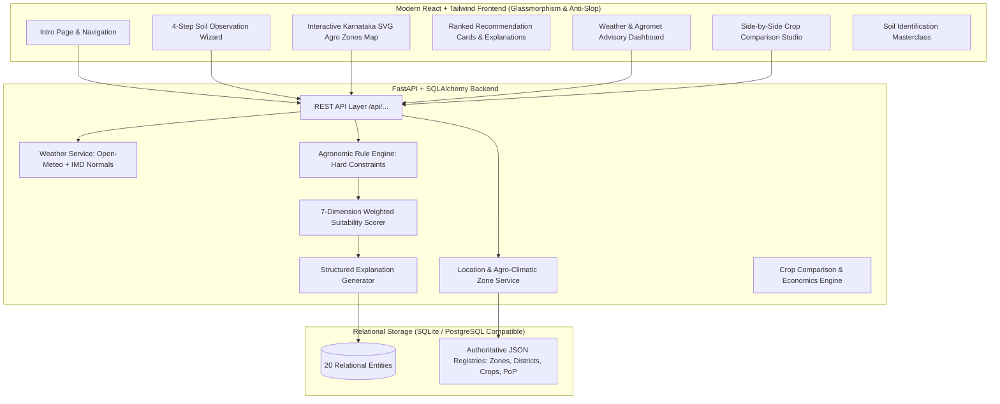

# SmartKrishi
### Observation-Based Smart Crop Recommendation & Agricultural Decision Support System
**A VTU Community Project for Karnataka's Farmers**

[](https://www.python.org/)
[](https://fastapi.tiangolo.com)
[](https://react.dev)
[](https://tailwindcss.com)
[](backend/tests/)
[](LICENSE)

---

## 🌾 Project Overview

**SmartKrishi** is an evidence-based agricultural decision-support system designed specifically for farmers who **do not have access to laboratory soil-testing facilities**. 

Rather than relying on farmers guessing complex chemical soil metrics (such as NPK values in kg/ha or exact soil pH), SmartKrishi uses **observable land characteristics**, geographical intelligence, agro-climatic zones, seasonal crop calendars, reliable weather observations, and documented agronomic rules from the **University of Agricultural Sciences (UAS) Bengaluru**, **UAS Dharwad**, and the **Indian Council of Agricultural Research (ICAR)**.

### 🌟 Core Innovations
1. **Zero Lab Testing Barrier**: Evaluates soil through physical, observable parameters: soil colour, texture (finger feel and ribbon length), post-rain drainage speed, moisture retention, and soil depth.
2. **Authoritative Karnataka Agro-Climatic Intelligence**: Mapped across all **31 districts** and **10 official Agro-Climatic Zones** of Karnataka.
3. **Hard Agronomic Constraints**: Enforces disqualification rules (e.g. waterlog-sensitive Groundnut or Red Gram in stagnant water; rainfed Sugarcane in low-rainfall dry zones).
4. **Hybrid Weather Intelligence**: Combines live meteorological telemetry (Open-Meteo API) with 30-year IMD climatological rainfall and temperature normals.
5. **No Hallucinated Recommendations**: Transparent, traceable, multi-dimensional scoring (7 agricultural dimensions) with explicit uncertainty quantification when data is missing.
6. **Bilingual Accessibility**: English and Kannada interface labels for Karnataka farmers.

---

## 🏛️ System Architecture



---

## 🗺️ Karnataka 10 Agro-Climatic Zones

The system covers all official agro-climatic divisions:
1. **Zone 1: North Eastern Transition Zone** (Bidar, northern Kalaburagi)
2. **Zone 2: North Eastern Dry Zone** (Raichur, Yadgir, Kalaburagi)
3. **Zone 3: Northern Dry Zone** (Vijayapura, Bagalkote, Gadag, Koppal, Ballari, Vijayanagara)
4. **Zone 4: Central Dry Zone** (Chitradurga, Davanagere, northern Tumakuru)
5. **Zone 5: Eastern Dry Zone** (Bengaluru Urban/Rural, Kolar, Chikkaballapura, Ramanagara)
6. **Zone 6: Southern Dry Zone** (Mandya, Mysuru, Chamarajanagara, southern Tumakuru)
7. **Zone 7: Southern Transition Zone** (Hassan, Shivamogga, Chikkamagaluru eastern taluks)
8. **Zone 8: Northern Transition Zone** (Dharwad, Belagavi, Haveri)
9. **Zone 9: Hilly Zone (Malnad)** (Kodagu, western Chikkamagaluru, western Hassan)
10. **Zone 10: Coastal Zone** (Dakshina Kannada, Udupi, Uttara Kannada)

---

## 🚀 Quickstart Guide

### Prerequisites
- **Python 3.10+** (Tested on Python 3.13)
- **Node.js 18+** & **npm 9+**
- **Git**

### 1. Clone the Repository
```bash
git clone https://github.com/YOUR_USERNAME/SmartKrishi.git
cd SmartKrishi
```

### 2. Backend Setup
```bash
# Install Python dependencies
python -m pip install -r backend/requirements.txt

# Seed the database with verified Karnataka data
python -m backend.app.seed
```

### 3. Frontend Setup & Build
```bash
# Navigate to frontend folder and install dependencies
cd frontend
npm install

# Build static bundle for production
npm run build
cd ..
```

### 4. Run the Full Application (Single-Command)
FastAPI automatically serves the built React frontend at `http://localhost:8000/` and the REST API at `http://localhost:8000/api/`:
```bash
python -m uvicorn backend.app.main:app --host 0.0.0.0 --port 8000 --reload
```
Open your browser at **[http://localhost:8000](http://localhost:8000)**!

> **Development Mode (Vite Dev Server)**:
> If you prefer working with hot-reloading on the frontend:
> - Terminal 1: `python -m uvicorn backend.app.main:app --port 8000 --reload`
> - Terminal 2: `cd frontend && npm run dev` (Runs at `http://localhost:5173`)

---

## 🧪 Testing and Validation

SmartKrishi includes a comprehensive test suite covering all **15 agricultural scenarios** specified by domain agronomists:

```bash
# Run pytest test suite
python -m pytest backend/tests -v
```

### Validated Test Scenarios:
1. `Red soil, sandy texture, limited irrigation` &rarr; Groundnut & Ragi ranked top, Sugarcane excluded.
2. `Dark black soil, clayey, waterlogged` &rarr; Pulses (Groundnut, Red Gram, Chickpea) excluded by hard constraints.
3. `Loamy soil, moderate water availability` &rarr; Balanced field crops (Ragi, Maize, Sunflower) selected.
4. `Shallow soil with rocky land` &rarr; Deep taproot crops (Sugarcane, Cotton) excluded; Horse Gram viable.
5. `Flat land with seasonal rainfall` &rarr; Prime northern transition crops (Soybean, Cotton, Maize) selected.
6. `Hilly land with high rainfall` &rarr; Slope constraints enforced; valley paddy and plantation agronomy.
7. `Rainfed cultivation with expected dry spell` &rarr; Drought-hardy dryland staples (Jowar, Sunflower) prioritized.
8. `Limited irrigation during season` &rarr; Short-duration pulses (Green Gram ~70d, Black Gram ~80d) favored.
9. `Unknown soil colour` &rarr; -5% uncertainty deduction applied; honest report of missing data.
10. `Unknown soil texture` &rarr; -15% uncertainty deduction; guides farmer to ribbon test.
11. `Missing live weather` &rarr; Gracefully falls back to IMD 30-year climatological normal baseline.
12. `Missing location` &rarr; Graceful unverified fallback with warning.
13. `Conflicting inputs (Paddy in rainfed dry zone)` &rarr; Hard constraints catch water deficit.
14. `Unsupported district query` &rarr; Proper 404 validation without crash.
15. `Crop comparison studio` &rarr; 3-way matrix populated with non-guaranteed economic benchmarks.

**Result: 15 / 15 Tests Passed (100% Pass Rate)**

---

## 📚 Technical Documentation Suite

Complete technical and project documentation is provided in the [`docs/`](docs/) directory:

- [Project Objectives & Problem Statement](docs/project-objectives.md)
- [Research & Literature Survey](docs/research-and-literature-survey.md)
- [Agricultural Data Sources Registry](docs/agricultural-data-sources.md)
- [Karnataka Agro-Climatic Zones Atlas](docs/Karnataka-agro-climatic-zones.md)
- [Soil Observation Methodology](docs/soil-observation-methodology.md)
- [Weather Intelligence Methodology](docs/weather-intelligence-methodology.md)
- [Recommendation Engine & Scoring Logic](docs/recommendation-engine.md)
- [Database Architecture & ERD](docs/database-architecture.md)
- [REST API Documentation](docs/API-documentation.md)
- [Testing & Validation Report](docs/testing-report.md)
- [Limitations & Future Scope](docs/limitations-and-future-scope.md)

---

## 🏛️ Project Credits & Data Sources
- **Indian Council of Agricultural Research (ICAR)**
- **University of Agricultural Sciences, Bengaluru (UASB)**
- **University of Agricultural Sciences, Dharwad (UASD)**
- **Karnataka State Department of Agriculture (KSDA)**
- **India Meteorological Department (IMD)**
- **Open-Meteo High-Resolution Numerical Weather Service**

---

## 📄 License
This project is licensed under the MIT License - see the [LICENSE](LICENSE) file for details.
