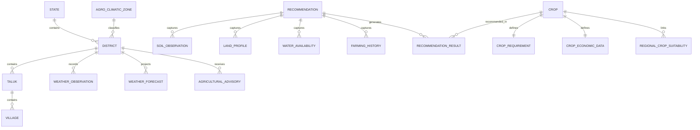

# Database Architecture and Entity-Relationship Model
## Relational Schema Design & PostgreSQL Compatibility Standard

### 1. Database Architecture Overview
The SmartKrishi storage layer is engineered with **SQLAlchemy 2.0 ORM** and uses **SQLite** for zero-dependency local execution, designed for drop-in compatibility with **PostgreSQL** in production cloud environments.

---

### 2. Entity-Relationship Diagram (ERD)

---

### 3. Detailed Entity Schemas (20 Core Entities)

1. **`states`**: Master administrative state table (`id`, `code`, `name`, `kannada_name`).
2. **`agro_climatic_zones`**: The 10 official Karnataka agro-climatic zones with headquarters, rainfall envelope, typical soils, and primary crops.
3. **`districts`**: All 31 Karnataka districts with coordinates, primary zone, secondary zone, normal rainfall, dominant soils, and drought vulnerability.
4. **`taluks`**: Sub-district administrative boundaries linked to districts and zones.
5. **`villages`**: Optional village-level granularity table.
6. **`soil_observations`**: Farmer-recorded physical traits (`soil_colour`, `soil_texture`, `drainage`, `moisture_retention`, `soil_depth`, `stones`, `erosion`, `waterlogging`).
7. **`land_profiles`**: Topographic parameters (`slope_type`, `approximate_area_acres`, `water_accumulation_risk`, `erosion_risk`).
8. **`water_availabilities`**: Irrigation resource records (`irrigation_source`, `availability_duration`, `has_drip_facility`).
9. **`farming_histories`**: Rotation memory (`previous_crop`, `previous_season`, `was_successful`, `recurring_pest_problem`).
10. **`crops`**: Core crop registry (`id`, `name`, `kannada_name`, `scientific_name`, `category`, `suitable_zones`, `suitable_districts`).
11. **`crop_requirements`**: Granular agronomic requirements (preferred textures, drainage tolerances, min-max water demand, optimal temperatures, sowing windows, rotation affinities).
12. **`regional_crop_suitabilities`**: Zone-specific adaptability tiers and local historical yield notes.
13. **`crop_economic_data`**: Verified benchmark costs per acre, average yield ranges, and official MSP.
14. **`weather_observations`**: Real-time atmospheric telemetry snapshots (`temperature_c`, `humidity`, `wind_speed`, `precipitation`, `source`).
15. **`weather_forecasts`**: 7-day projected daily weather metrics.
16. **`agricultural_advisories`**: Agromet alerts, heavy rainfall advisories, and sowing windows.
17. **`recommendations`**: Master recommendation evaluation session record (`district`, `zone_id`, `season`, `reliability_score_pct`, `completeness_pct`).
18. **`recommendation_results`**: Individual candidate crop results (`crop_id`, `rank`, `suitability_score`, `tier`, sub-scores, structured reasons, risks, and practices).
19. **`knowledge_articles`**: Educational library covering soil identification, water management, and crop rotation.
20. **`data_sources`**: Authoritative provenance registry tracking collection dates, verification dates, license terms, and update frequency.
21. **`farmer_feedback`**: Farmer rating, outcome tracking, and usability feedback.
