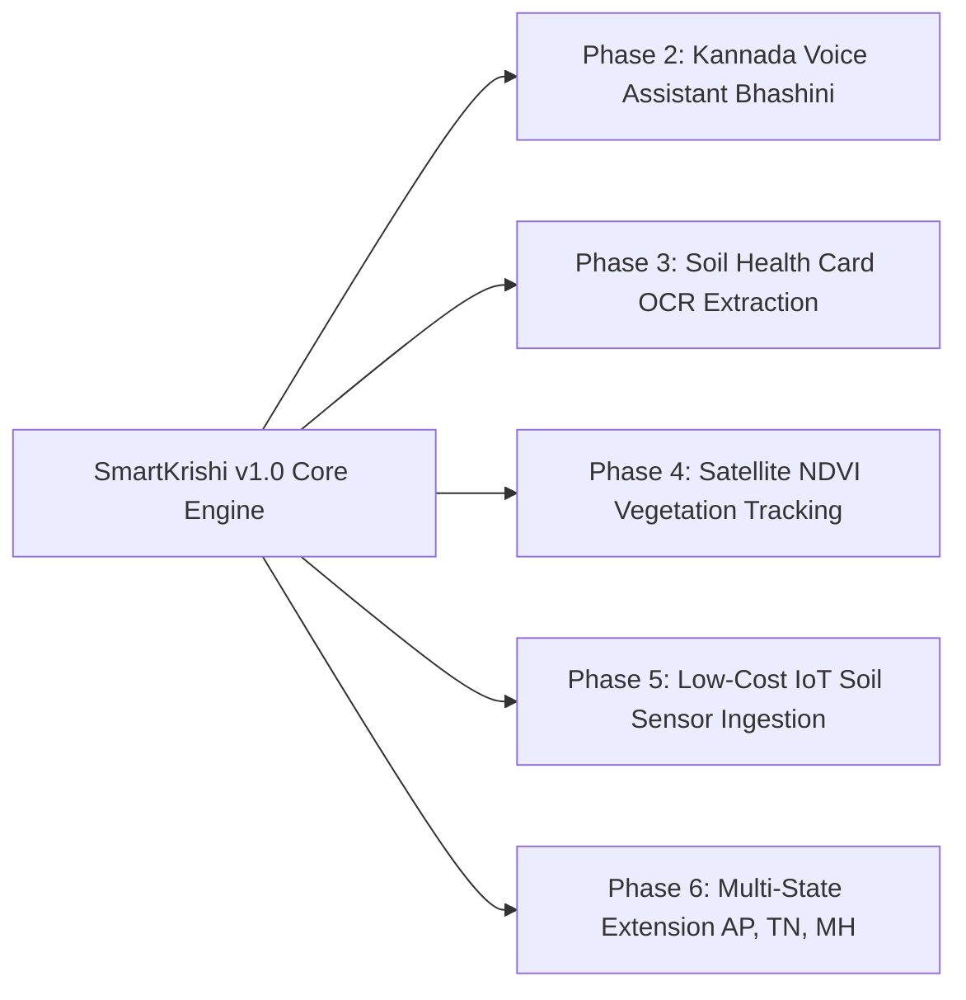

# Limitations and Future Scope
## VTU Community Project Technical Evaluation

### 1. Prototype Limitations and Boundaries
SmartKrishi is designed as an agricultural decision-support prototype. In keeping with scientific integrity, the following limitations are explicitly recognized:

1. **Subjectivity of Farmer Observations**: The ribbon and finger-feel test is widely used in agricultural extension, but variance exists between individual farmers when judging ribbon length or drainage speed.
2. **Micro-Topographic Nuances**: While the system resolves locations to taluks and agro-climatic zones, local field micro-climates (such as valley frost pockets or localized rain shadows) may differ from district averages.
3. **Acute Extreme Weather Outbreaks**: Seasonal rainfall normals provide a probabilistic baseline, but unpredicted extreme cloudbursts or cyclonic depressions cannot be predicted months in advance.
4. **Market Price Fluctuations**: Economic return indicators use official government Minimum Support Price (MSP) and CACP benchmarks. Actual realization at local APMC mandis varies with post-harvest supply gluts and quality grades.
5. **Soil Salinity and Alkalinity**: Visual observations cannot measure sub-surface electrical conductivity ($EC$) in saline canal patches without a digital conductivity meter.

---

### 2. Future Scope and Extensibility Roadmap

1. **Kannada Voice Interface (AI4Bharat / Bhashini Integration)**:
   - Voice input in colloquial Kannada dialects (North Karnataka, Mysore, Coastal) and spoken audio readout of recommendations for non-literate farmers.
2. **Soil Health Card (SHC) Document Scanner**:
   - For farmers who possess a Soil Health Card, an OCR module can extract laboratory NPK/pH values and fuse them with physical land observations.
3. **Satellite Remote Sensing (Copernicus Sentinel-2 & Landsat-8)**:
   - Ingesting Normalized Difference Vegetation Index (NDVI) and Soil Moisture Active Passive (SMAP) data to monitor field moisture stress.
4. **IoT Micro-Weather and Soil Probe Integration**:
   - Interfacing with low-cost solar-powered soil moisture sensors installed in farm ponds or borewell command areas.
5. **Geographic Expansion**:
   - Extending the modular location and crop knowledge base to include dryland regions across Maharashtra (Vidarbha/Marathwada), Andhra Pradesh (Rayalaseema), and Tamil Nadu.
