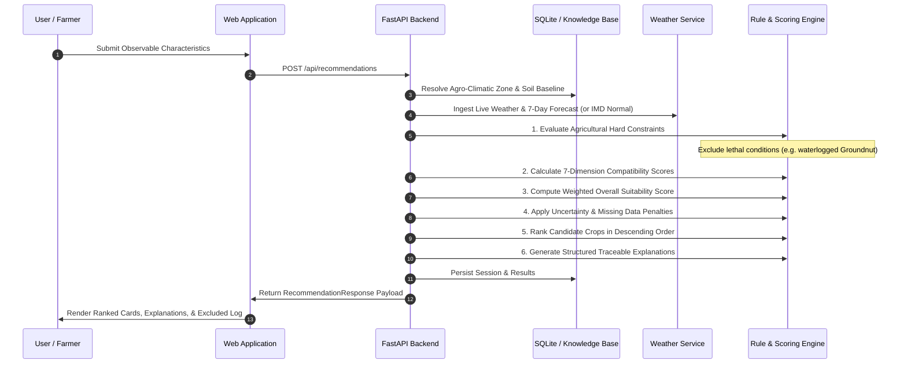

# Recommendation Engine Architecture and Scoring Logic
## Multi-Dimensional Agricultural Suitability Decision Algorithm

### 1. Introduction
The SmartKrishi recommendation engine replaces arbitrary black-box classifiers with a transparent, rule-governed agronomic suitability system. It integrates hard agricultural constraints, multi-factor weighted scoring, and explicit uncertainty quantification.

---

### 2. The 15-Step Recommendation Workflow

---

### 3. Agricultural Hard Constraints (Disqualification Rules)
A critical feature of SmartKrishi is that a high score in one dimension **cannot compensate** for a fatal constraint in another.

| Hard Constraint Type | Trigger Condition | Disqualified Crops | Agronomic Rationale |
|:---|:---|:---|:---|
| **Lethal Drainage / Waterlogging** | Drainage = "Water remains for one or more days" OR Low-lying land with waterlogging | Groundnut, Red Gram, Chickpea, Sesamum, Onion | Root zone hypoxia, fungal collar rot, and total asphyxiation within 24-48 hours |
| **Water Deficit Constraint** | Irrigation = "Rainfed" AND District Normal Rain < 900 mm | Sugarcane, Wetland Paddy | Water requirements (>1200-2500 mm) exceed available precipitation; guaranteed crop failure |
| **Root Depth Restriction** | Soil Depth = "Shallow (<25 cm)" | Sugarcane, Cotton | Taproot restriction (>1.5 m anchor needed); severe lodging and yield collapse |
| **Cracking Clay Incompatibility** | Soil Texture = "Clayey" AND Colour = "Dark black" | Groundnut | Gynophores (pegs) cannot penetrate hard dry clay crust; pods detach in soil at harvest |
| **Lethal Thermal / Season Mismatch** | Season = "Summer" ($T > 35^\circ\text{C}$) | Bengal Gram (Chickpea) | Strict cool-season Rabi legume; high temperatures induce flower drop and scorching |
| **Topography Incompatibility** | Land Slope = "Steep or hilly land" | Wetland Paddy, Sugarcane | Inability to maintain standing water basins; severe soil erosion |

---

### 4. Mathematical Scoring Formulation
For every candidate crop surviving hard constraints, the system computes seven normalized sub-scores ($S_i \in [0, 100]$) and aggregates them using configurable agronomic weights ($W_i$):

$$\text{Suitability Score} = \min\left(100, \max\left(0, \sum_{i=1}^{7} (S_i \times W_i) + \Delta_{\text{rotation}}\right)\right)$$

#### Configurable Weights ($W_i$)

| Sub-Score Dimension ($S_i$) | Agronomic Weight ($W_i$) | Evaluation Focus |
|:---|:---:|:---|
| **Soil Texture Compatibility** ($S_{\text{soil}}$) | **0.20** | Physical fit for preferred (100%), acceptable (75%), or unsuitable (25%) textures |
| **Water Availability Compatibility** ($S_{\text{water}}$) | **0.20** | Irrigation reliability & duration vs crop seasonal water requirement ($CWR$) |
| **Drainage Compatibility** ($S_{\text{drain}}$) | **0.15** | Infiltration speed and soil depth ($>25\text{ cm}$) matching root aeration needs |
| **Regional Geographic Suitability** ($S_{\text{region}}$) | **0.15** | Official presence in zone and district historical cultivation records |
| **Rainfall Normal Compatibility** ($S_{\text{rain}}$) | **0.10** | Comparison of district normal rainfall against crop optimal moisture envelope |
| **Temperature Compatibility** ($S_{\text{temp}}$) | **0.10** | Thermal range match with current telemetry and seasonal averages |
| **Seasonal Sowing Compatibility** ($S_{\text{season}}$) | **0.10** | Alignment with state crop calendars (Kharif, Rabi, Summer) |

#### Crop Rotation Adjustment ($\Delta_{\text{rotation}}$)
- **Pulse-Cereal Synergism (+8%)**: Preceding grain legume fixes nitrogen and boosts following cereal.
- **Continuous Mono-Cropping (-12%)**: Repeating identical crop (e.g. Red Gram after Red Gram) induces *Fusarium* wilt and nutrient exhaustion.

---

### 5. Uncertainty Quantification and Reliability Index
Unlike commercial apps that claim "99.8% precision", SmartKrishi calculates an honest **Reliability Index**:

$$\text{Reliability Score} = 100 - \sum \text{Penalties}_{\text{unknown}}$$

- **Unknown Soil Texture**: $-15\%$
- **Unknown Drainage**: $-10\%$
- **Unknown Moisture Duration**: $-8\%$
- **Unknown Soil Depth**: $-7\%$
- **Missing Live Weather (IMD Baseline used)**: $-5\%$
- **Unknown Soil Colour**: $-5\%$

When inputs are omitted, the recommendation confidence transparently decreases, and the missing fields are reported to the farmer.
