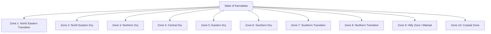

# Research and Literature Survey: Karnataka Dryland Agronomy
## VTU Community Project &bull; Agricultural Decision Support Foundations

### 1. Introduction
Agricultural decision support requires synthesising multi-disciplinary research from pedology, agro-climatology, irrigation engineering, and crop physiology. This survey documents the authoritative references, research papers, and institutional sources underpinning SmartKrishi.

---

### 2. Agro-Climatic Classification of Karnataka
According to the **Planning Commission of India** and the **Karnataka State Department of Agriculture (KSDA)**, Karnataka is stratified into **10 Agro-Climatic Zones** based on rainfall pattern, soil groups, topography, and cropping systems:

#### Key Zone Characteristics
1. **Zones 2, 3, 4 (Dry Zones)**: Rainfall ranges from 450 to 750 mm. Vertisols (deep black cotton soils) dominate Zone 3, conserving moisture for post-monsoon Rabi cropping (Jowar, Chickpea). Alfisols (red sandy loams) dominate Zone 4 (Chitradurga, Pavagada), where Groundnut and Ragi are staples.
2. **Zones 1, 7, 8 (Transition Zones)**: Moderate bimodal rainfall (700-1100 mm). High crop diversity (Soybean, Cotton, Maize, Chilli, Pulses).
3. **Zones 5, 6 (Eastern & Southern Dry)**: Traditional Ragi (Finger Millet) heartland (700-880 mm). Major irrigation commands along Cauvery, KRS, and Kabini.
4. **Zones 9, 10 (Malnad & Coastal)**: Per-humid to humid tropical (>1500 to 4000 mm). Paddy in valleys, plantation crops (Coffee, Arecanut, Pepper) on terraced hillsides.

*Reference: UAS Bengaluru & KSDA, "Agro-Climatic Atlas of Karnataka", Directorate of Agriculture, Govt. of Karnataka.*

---

### 3. Pedological Soil Observation Without Laboratory Chemistry
Soil physical properties exert first-order control over plant establishment and root respiration:

#### A. The Ribbon and Finger Feel Method (USDA-NRCS & FAO Standard)
Standardised by Thien (1979) and adopted by ICAR Central Soil Salinity Research Institute:
- **Sand**: Non-cohesive, particles >0.05 mm, grittiness dominates, zero ribbon formation. High infiltration (>50 mm/hr), low moisture retention (<8%).
- **Loam**: Silt and clay balance sand particles. Forms flexible 2.5 to 3.5 cm ribbons. Infiltration 10-25 mm/hr, optimal plant-available water holding capacity (15-20%).
- **Clay (Vertisols)**: Contains >40% smectite/montmorillonite expanding-lattice clays. Forms long, shiny ribbons (>5.0 cm). High plasticity, very slow infiltration (<2 mm/hr), prone to waterlogging when saturated and wide shrinkage cracks when dry.

*Reference: Thien, S.J. (1979). "A flow diagram for teaching soil texture by feel". Journal of Agronomic Education, 8: 54-55.*

#### B. Soil Colour as an Indicator, Not Nutrient Measure
Soil color reflects iron mineralogy and hydrology:
- **Red (Hematite $\text{Fe}_2\text{O}_3$)**: Indicates well-aerated, oxidized conditions typical of upland Alfisols.
- **Dark Black (Smectite + Humus complexes)**: Deep Vertisol plains; high calcium and magnesium saturation.
- **Grey/Mottled**: Indicates anaerobic reduction (gleying) due to prolonged water saturation.

*Scientific Caution*: Research by ICAR-NBSS&LUP demonstrates that soil color alone does not correlate linearly with available nitrogen or phosphorus. SmartKrishi uses colour strictly as a supporting geological/drainage indicator.

---

### 4. Crop Water Requirements (CWR) and Irrigation Matching
According to FAO Irrigation and Drainage Paper No. 56 (Allen et al., 1998) and UAS Bengaluru Package of Practices:
- **Crop Evapotranspiration ($ET_c$)**: $ET_c = K_c \times ET_0$
- Documented season-long water requirements ($mm$):
  - **Finger Millet (Ragi)**: 350 - 450 mm (High water-use efficiency $C_4$ plant)
  - **Rabi Jowar (Sorghum)**: 350 - 500 mm
  - **Chickpea (Bengal Gram)**: 250 - 350 mm (Grown on conserved soil moisture)
  - **Groundnut**: 450 - 600 mm (Critical moisture needed at flowering and pegging)
  - **Maize**: 550 - 750 mm (Highly sensitive to waterlogging and drought at silking)
  - **Wetland Paddy**: 1200 - 1600 mm (Requires standing water or intermittent ponding)
  - **Sugarcane**: 1800 - 2500 mm (Perennial water demand; unsustainable without canal/borewell)

---

### 5. Crop Rotation and Soil-Borne Disease Interruption
Agronomic studies by the **Indian Institute of Pulses Research (IIPR)** demonstrate:
1. **Pulse-Cereal Synergism**: Legumes fix 30 to 80 kg N/ha, sparing chemical fertilizer for the following cereal crop.
2. **Fusarium Wilt Management**: Continuous Pigeonpea or Chickpea cultivation causes exponential spore accumulation of *Fusarium udum* and *Fusarium oxysporum*. Rotating with Sorghum, Maize, or Ragi breaks the fungal life cycle.

---

### 6. Literature Summary Matrix
| Source Institutional Body | Contribution to SmartKrishi | Verification Date |
|:---|:---|:---|
| **ICAR** (Indian Council of Agricultural Research) | Crop water requirements, disease thresholds, dryland guidelines | August 2024 |
| **UAS Bengaluru** (GKVK) | Southern/Eastern Karnataka Package of Practices, Ragi agronomy | September 2024 |
| **UAS Dharwad** | Northern Karnataka Vertisol agronomy, Rabi Jowar, Chickpea, Cotton | September 2024 |
| **IMD** (India Meteorological Department) | 30-Year Climatological Rainfall & Temperature Normals | August 2024 |
| **KSDA** (Dept of Agriculture Karnataka) | District taluk boundaries, agro-climatic zone classifications | July 2024 |
| **CACP** (Govt of India) | Minimum Support Price (MSP) and cultivation cost benchmarks | October 2024 |
