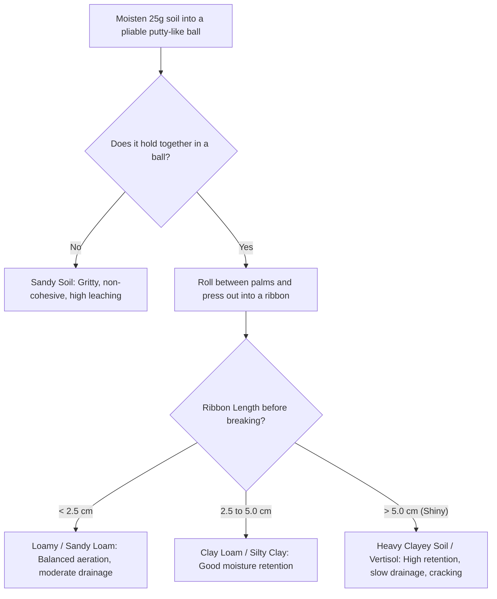

# Soil Observation Methodology: Farmer-Led Field Assessment
## Non-Laboratory Soil Evaluation Protocol for Smallholder Farmers

### 1. Rationale for Observation-Based Soil Analysis
Traditional crop recommendation models fail smallholder farmers by requiring laboratory data (e.g., Nitrogen in kg/ha, Phosphorus in kg/ha, Potassium in kg/ha, and pH value). Soil testing laboratories are inaccessible to most rural farmers, causing them to enter arbitrary numbers.

SmartKrishi establishes an **evidence-based observation methodology** where the physical parameters that dictate root anchoring, hydraulic conductivity, aeration, and moisture retention are recorded directly by the farmer.

---

### 2. Observable Soil Parameter Definitions

#### A. Soil Texture by the Ribbon and Feel Test
Soil texture refers to the relative proportions of sand (0.05 - 2.0 mm), silt (0.002 - 0.05 mm), and clay (<0.002 mm).

1. **Sandy Soil**: Cannot form a ribbon. Rapid drainage (>50 mm/hr). Requires frequent light water applications; susceptible to nutrient leaching. Best for Groundnut, Sesamum, Horse Gram.
2. **Loamy Soil**: Forms a moderate ribbon (2.5 - 3.5 cm) that breaks easily. Balanced pore space (50% solid, 25% water, 25% air). Optimal benchmark for Ragi, Maize, Red Gram.
3. **Clayey Soil**: Forms a long (>5.0 cm), shiny, flexible ribbon. Becomes very sticky when wet and develops deep shrinkage cracks when dry. Retains water for several days. Highly suitable for post-monsoon Rabi crops (Chickpea, Rabi Jowar, Cotton) and wetland Paddy.
4. **Silty Soil**: Feels silky and floury like talcum powder when dry; slippery and soapy when wet, but non-sticky. Forms a weak ribbon (1.5 - 2.5 cm). Prone to surface crusting under heavy rain.

---

### 3. Drainage and Soil Moisture Retention Observation

#### A. Post-Rainfall Drainage Duration
The farmer observes standing surface water after a typical soaking rain event (25-50 mm):
- **Water drains quickly**: Absorbed within minutes. Indicates coarse texture or gravelly subsoil.
- **Water drains moderately**: Steady percolation within 2 to 6 hours. Ideal root zone aeration.
- **Water remains for several hours**: Pools briefly for 6 to 12 hours before soaking. Tolerated by cereals, risky for pulses.
- **Water remains for one or more days**: Saturated standing water for >24 hours. **Triggers hard constraint exclusion** for Groundnut, Red Gram, Chickpea, and Sesamum due to root asphyxiation (*hypoxia*).

#### B. Soil Moisture Retention
- **Dries quickly**: Surface turns dusty within 1 to 2 sunny days.
- **Retains moisture for a short period**: Stays damp for 3 to 5 days.
- **Retains moisture for several days**: Dark damp profile preserved for 7 to 14 days. Ideal for Rabi double-cropping.

---

### 4. Soil Depth Measurement
Measured by digging a simple 30 cm inspection hole or using an iron crowbar:
- **Shallow (<25 cm)**: Underlain by hard bedrock, calcic kankar, or gravelly hardpan. Filters out deep-rooted crops (Sugarcane, Cotton, long-duration Red Gram).
- **Medium (25 - 75 cm)**: Standard profile for annual field crops (Ragi, Groundnut, Maize, Jowar).
- **Deep (>75 cm)**: Expansive profile allowing deep rooting systems (>1.5 m) to tap subsoil moisture.

---

### 5. Scientific Clarification on Soil Colour
Soil colour is an indicator of mineral composition and drainage state:
- **Red / Reddish Brown**: Indicates oxidized ferric iron ($\text{Fe}^{3+}$). Found in well-drained Alfisols of Southern Karnataka.
- **Dark Black**: Indicates smectite-humus clay complexes (Vertisols) of Northern Karnataka basalt plateaus.
- **Grey / Mottled**: Indicates periodic anaerobic reduction ($\text{Fe}^{2+}$) due to a fluctuating water table.

> **Important Scientific Notice**: Soil colour alone cannot establish fertility or exact chemical NPK values. SmartKrishi uses colour strictly as a supporting indicator for geological classification.
