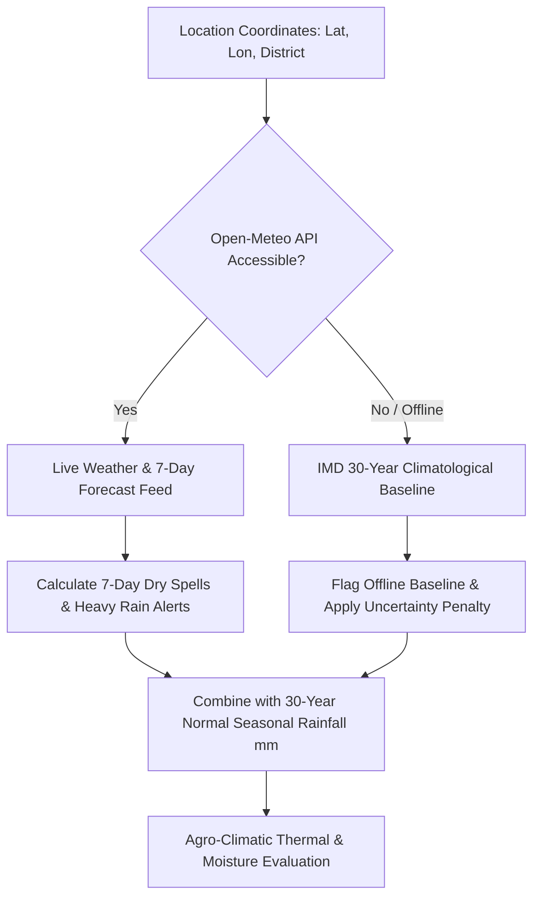

# Weather and Climate Intelligence Methodology
## Hybrid Atmospheric Processing & Climatological Modeling

### 1. Conceptual Framework
A fundamental error in rudimentary agricultural apps is conflating **short-term weather forecasts** with **long-term crop suitability**. A 5-day weather forecast of clear skies cannot determine whether a 120-day crop will have adequate seasonal rainfall.

SmartKrishi implements a layered meteorological intelligence pipeline:

---

### 2. Meteorological Data Sources and Ingestion

#### A. Historical Climatological Normals (30-Year Epoch 1981-2010)
- **Source**: India Meteorological Department (IMD).
- **Parameters**: Monthly normal rainfall ($mm$), mean daily maximum and minimum temperatures, and decadal dry spell frequencies for all 31 districts of Karnataka.
- **Role in Engine**: Provides the long-term moisture and thermal baseline against which crop season water demands ($CWR$) are matched.

#### B. Live Weather Telemetry and 7-Day Numerical Forecast
- **Source**: Open-Meteo Global Numerical Weather Prediction (ECMWF / WMO model assimilation).
- **Parameters Queried**:
  - `temperature_2m`: Current air temperature (°C).
  - `relative_humidity_2m`: Ambient relative humidity (%).
  - `wind_speed_10m`: Surface wind velocity (km/h).
  - `precipitation`: Recent rainfall accumulation (mm).
  - `daily`: 7-day projection of $T_{max}$, $T_{min}$, precipitation sum ($mm$), and rain probability (%).

---

### 3. Derived Agrometeorological Metrics

#### A. Dry Spell Risk Metric
According to ICAR Agrometeorology standards, a **dry spell** during the active monsoon season is defined as **five or more consecutive days** where daily precipitation is less than $2.5\text{ mm}$:

$$\text{Dry Spell Condition} = \sum_{d=1}^{n} \mathbb{I}(P_d < 2.5\text{ mm}) \ge 5$$

- **Actionable Trigger**: When the 7-day forecast indicates $\ge 5$ dry days, the system automatically triggers an agricultural advisory urging farmers to implement dust-mulching, straw cover, or schedule protective life-saving irrigation from a farm pond.

#### B. Heavy Rainfall and Stagnation Alert
- **Heavy Rainfall Event**: Single-day forecasted precipitation $> 50\text{ mm}$ (IMD threshold).
- **Actionable Trigger**: Alerts the farmer to inspect and excavate drainage furrows around waterlogging-sensitive crops (Red Gram, Maize, Groundnut) and halt chemical spraying or top-dressing of nitrogen.

#### C. Thermal Suitability Index ($S_{temp}$)
Crops exhibit cardinally distinct base, optimal, and maximum thermal thresholds:

$$S_{temp} = 
\begin{cases} 
100 & \text{if } T_{opt\_min} \le T_{current} \le T_{opt\_max} \\
80 & \text{if } (T_{opt\_min} - 4) \le T_{current} \le (T_{opt\_max} + 4) \\
55 & \text{otherwise}
\end{cases}$$

Example: Chickpea requires cool temperatures ($18-28^\circ\text{C}$). If current or seasonal temperatures exceed $35^\circ\text{C}$, thermal abortion of flowers occurs, and the crop is penalized or excluded.

---

### 4. Data Provenance and Offline Graceful Degradation
Every response payload from the weather module includes:
- `source`: `"Open-Meteo High-Resolution Forecast Model"` or `"IMD 30-Year Climatological Historical Normals (Offline Baseline)"`.
- `retrieval_timestamp`: UTC timestamp of the observation.
- `is_live_data`: Boolean flag.
- **Uncertainty Penalty**: If live weather cannot be retrieved due to network disconnects, the system reduces the overall recommendation reliability score by **5%** and alerts the farmer transparently.
